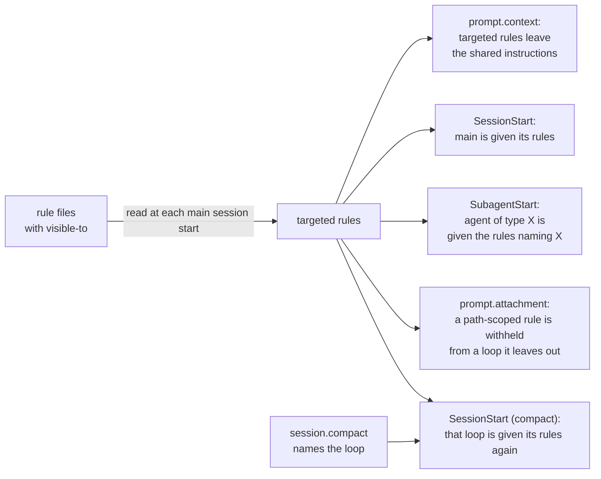

<div align="center">


# rule-control

**Claude Code plugin for per-loop rule delivery — a rule file names the loops that receive it: the main chat, chosen agent types, or all**

[](https://github.com/rezzminator/rule-control/actions/workflows/release.yml)
[](./CHANGELOG.md)
[](./LICENSE)
[](https://code.claude.com/docs/en/plugins)
[](https://github.com/rezzminator/professor)

**Contents:** [Why](#-why) · [Quick start](#-quick-start) · [Usage](#-usage) · [How it works](#-how-it-works) · [Logs](#logs) · [Limits](#️-limits) · [FAQ](#-faq) · [Help](#-help) · [Contributing](#-contributing) · [Built with Professor](#-built-with-professor) · [License](#license) · [Changelog](./CHANGELOG.md)

</div>

Claude Code gives every rule file in `~/.claude/rules/` and `.claude/rules/` to every loop: the main chat and each sub-agent it spawns. A rule written for the orchestrator (how to dispatch, when to merge, who commits) lands in every helper's context too, where it costs tokens and invites the helper to act on orders that are not its own.

One frontmatter key names the loops a rule reaches:

```markdown
---
visible-to:
  include: [main]          # only the main chat receives this rule
---

# Dispatch

Hand every build to a foreman; merge only after the lander passes.
```

With three rules in `~/.claude/rules/`, each loop receives:

| Rule | `visible-to` | main chat | `reviewer` | `Explore` |
| --- | --- | --- | --- | --- |
| `dispatch.md` | `include: [main]` | ✓ | — | — |
| `review-checklist.md` | `include: [reviewer, reviewer-*]` | — | ✓ | — |
| `style.md` | none | ✓ | ✓ | ✓ |

## 🤔 Why

- **Every loop gets the rules its job needs, not all of them.** An orchestration rule stays with the main chat; a checklist reaches only the agent types that use it.
- **One place for every rule.** A rule for a sub-agent can live beside the others in `.claude/rules/` instead of being pasted into each agent's prompt, and one glob (`reviewer-*`) covers a family of agents.
- **Agents you do not own are covered too.** Built-in agents (`Explore`, `general-purpose`) and plugin agents have no file of yours to edit; a rule can still name them or leave them out.
- **Rules survive compaction.** A loop that compacts is given its rules again, and only its own.
- **It never loses a rule by accident.** A malformed `visible-to`, an unreadable file or a failing hook is logged with its context, and the rule goes on reaching every loop, as it did before the plugin.

## 🚀 Quick start

Function hooks are experimental; turn them on before Claude Code starts:

```bash
export CLAUDE_CODE_ENABLE_FUNCTION_HOOKS=1
```

Install from Professor's marketplace:

```bash
claude plugin marketplace add rezzminator/professor
claude plugin install rule-control@professor
```

<details>
<summary>From a checkout, or from inside a session</summary>

From a clone of this repository, for one session:

```bash
claude --plugin-dir plugins/rule-control
```

Inside a session:

```text
/plugin marketplace add rezzminator/professor
/plugin install rule-control@professor
```

</details>

Add a `visible-to` key to a rule file, then start a new session (or `/clear`): rules are read at each session start.

Remove it with:

```bash
claude plugin uninstall rule-control@professor
```

## 🧭 Usage

### The `visible-to` key

A top-level key in a rule file's frontmatter:

```yaml
---
visible-to:
  include: [main, reviewer, "research-*"]   # only these loops
  exclude: [research-scout]                 # minus these
---
```

- A loop is `main` (the main chat) or an agent type as Claude Code names it: `Explore`, `general-purpose`, `my-agent`, `my-plugin:my-agent`.
- A name is exact or a `*` glob: `reviewer-*` matches `reviewer-pro`, `*` matches every loop.
- `include` keeps only the loops it matches (every loop when absent); `exclude` drops the loops it matches; together, the included minus the excluded. `include: []` reaches no loop.
- No `visible-to` key, `visible-to: {}`, or `include: ["*"]` with no `exclude`: the rule reaches every loop, as without the plugin.
- Both flow and block lists work: `include: [main, reviewer]`, or one `- name` per line under `include:`. `visible-to: {include: [main]}` is one line.

### Where rules are read

- The user tier: `$CLAUDE_CONFIG_DIR/rules/`, else `~/.claude/rules/`.
- The project tier: `.claude/rules/` in the session's directory and each directory above it, stopping below your home directory, as Claude Code reads them.
- A nested `.claude/rules/` that Claude Code loads when a file under it is touched is read when its rule is delivered.
- Every `*.md` file, in subdirectories too, with symbolic links followed; a file reached by two paths is read once.

Rules are read again at each main-chat session start: a new session, `/resume`, `/clear` and each compaction of the main chat. An edit applies from the next one.

### Path-scoped rules

A rule with `paths:` reaches a loop when that loop touches a matching file, as Claude Code delivers it. With `visible-to` too, it reaches only the loops `visible-to` admits: a loop it leaves out does not get it, whatever files it touches.

```yaml
---
paths: ["migrations/**"]
visible-to: { include: [main] }
---
```

### A malformed key

A `visible-to` that cannot be read keeps the rule, reaching every loop, and says why on screen and in the plugin log:

```text
rule-control: ~/.claude/rules/deploy.md: visible-to has an unknown key "only"; use include or exclude; the rule is kept and reaches every loop
```

## 🧠 How it works

Claude Code builds the instruction context (every `CLAUDE.md` and rule file) once and gives the same text to every loop, so a rule cannot be left out of one loop there. rule-control takes each targeted rule (a readable `visible-to` that leaves some loop out) out of that shared text and hands it to each loop it names on its own.



A loop is given its rules as one block of hook context, opened by `rule-control: the rules below reach this loop by their visible-to frontmatter.` and followed by each rule in the shape Claude Code renders instruction files: `Contents of {path} ({tier}):` and the rule's body, without its frontmatter.

### classic.SessionStart

At every main-chat start (startup, resume, clear, compact, fork) reads the rules again and gives the main chat the targeted rules that name `main`. A compaction's start goes to the loop the compaction named instead (below).

### prompt.context

Takes each targeted rule out of the shared instruction context. A rule stays in it, reaching every loop, when it imports other files (`@path`), whose text rule-control cannot hand on, or when it names `main` and the main chat was not given it at its last start (a rule added mid-session).

### classic.SubagentStart

Gives a starting sub-agent the targeted rules its agent type matches.

### prompt.attachment

Withholds a path-scoped rule (`nested_memory`) from a loop its `visible-to` leaves out.

### session.compact

Claude Code starts a compacted loop with a `SessionStart` (source `compact`) that does not say which loop compacted. `session.compact` does, so rule-control pairs each compaction with the next such start and gives that loop its own rules: a sub-agent's compaction gives it its type's rules, never the main chat's.

### session.end

Drains pending plugin log writes.

It fails open: an unreadable rule or rules directory, a malformed `visible-to`, a sub-agent whose type cannot be resolved, a hook that throws, or any other error is logged with its context, and the rule goes on reaching every loop Claude Code gives it to. A rule silently lost is worse than one over-delivered.

### Logs

Rows append to `errors.jsonl`, `warnings.jsonl`, `info.jsonl` and `debug.jsonl` under `$PLUGIN_LOG_DIR/rule-control/`, else `$HOME/.local/state/rule-control/logs/`. Each row names the event, the hook, the session id when available, and the rule paths and loop it concerns; it never holds a rule's body, a prompt or a transcript.

| Level | Events |
| --- | --- |
| error, also on screen | `frontmatter-problem`, `rule-unreadable`, `rules-dir-unlisted`, `user-tier-skipped`, `discovery-failed`, `imports-kept`, `context-rewritten`, `agent-list-failed`, `loop-unresolved`, `hook-threw` |
| warning | `compaction-unpaired` |
| info | `delivered`: a loop given its targeted rules, with their paths |
| debug | `shared-filtered`, `withheld`, `engine-loop` |

A missing rules directory is no error and logs nothing. Each problem with a rule file is logged once per plugin load, however often the rule is read.

The log writer is a vendored copy of the shared plugin-log library (`src/plugin-log.ts`), kept byte-identical to its canonical source: rows stay within 4096 bytes, files and directories are private (0600, 0700), a level file over 20 MiB rotates through five generations, and a failed write keeps its rows for the next one.

## ⚠️ Limits

- Requires function hooks (`CLAUDE_CODE_ENABLE_FUNCTION_HOOKS=1`); tested live on Claude Code 2.1.316, which CI validates against.
- Claude Code only. Codex and OpenCode read the same rule files through their own instruction mechanisms, which have no per-loop delivery: a tool that mirrors these rules there (such as Professor's engine-sync) delivers a targeted rule to every loop.
- Rule files only: a `CLAUDE.md` file reaches every loop, as before.
- A targeted rule reaches a loop as hook context (a message at the loop's start), not inside the system prompt as an instruction file does.
- A sub-agent that starts with no instruction context (an agent type defined to omit `CLAUDE.md`) is still given the targeted rules that name it.
- A fork of the main chat inherits the main chat's conversation, so it holds what the main chat was given.
- At a session's first start, `claudeMdExcludes` is not yet known: the main chat is given its targeted rules even where that setting excludes them. From the next start on, the plugin follows the files Claude Code loaded.
- A targeted rule that imports other files (`@path`) stays in the shared context and reaches every loop; an error line says so.
- A compaction answered by another plugin's hook running before rule-control, or two compactions overlapping, starts a loop rule-control cannot name: that loop is given every targeted rule, and a `compaction-unpaired` warning is logged.
- Managed-policy rules (the system-wide tier an administrator sets) are not read for `visible-to`.
- A rule added mid-session that names the main chat reaches every loop until the next session start.
- It is a convenience, not a security boundary: it fails open.

## ❓ FAQ

**Does it cost anything?** At each main-chat start, one directory listing per rules directory and one read per rule file. Per sub-agent, one lookup in the session's agent list for its type. No model call, no network request. Each nonempty log write runs one short shell process.

**Why not put the text in the agent's own prompt?** That works for an agent file you own. It cannot reach the main chat, a built-in agent or a plugin's agent, and one rule cannot cover a family of agents by glob. The two combine.

**Why not `paths:`?** `paths:` scopes a rule by the files a loop touches, not by which loop it is. The two combine: a rule with both reaches a loop only when both admit it.

**What does a sub-agent see?** Its targeted rules, as hook context at its start, and every rule without `visible-to` in its instruction context, as before.

## 💬 Help

Questions and bugs go to [issues](https://github.com/rezzminator/rule-control/issues/new/choose); [SUPPORT.md](./SUPPORT.md) says what to include. Security problems: [SECURITY.md](./SECURITY.md), never a public issue.

## 🤝 Contributing

[CONTRIBUTING.md](./CONTRIBUTING.md) covers the layout, the gates and where a change goes; open issues labelled [good first issue](https://github.com/rezzminator/rule-control/issues?q=is%3Aissue+is%3Aopen+label%3A%22good+first+issue%22) are a place to start. Everyone taking part follows the [Code of Conduct](./CODE_OF_CONDUCT.md).

## 🎓 Built with Professor

rule-control is built and maintained with [Professor](https://github.com/rezzminator/professor), a fleet controller and discipline layer for Claude Code, Codex and OpenCode: chats that message each other, agents held to the project's rules, and gated releases. This plugin came out of it: Professor's rules bind the main chat that dispatches and merges, and every helper agent used to read them too.

## License

[MIT](./LICENSE)
